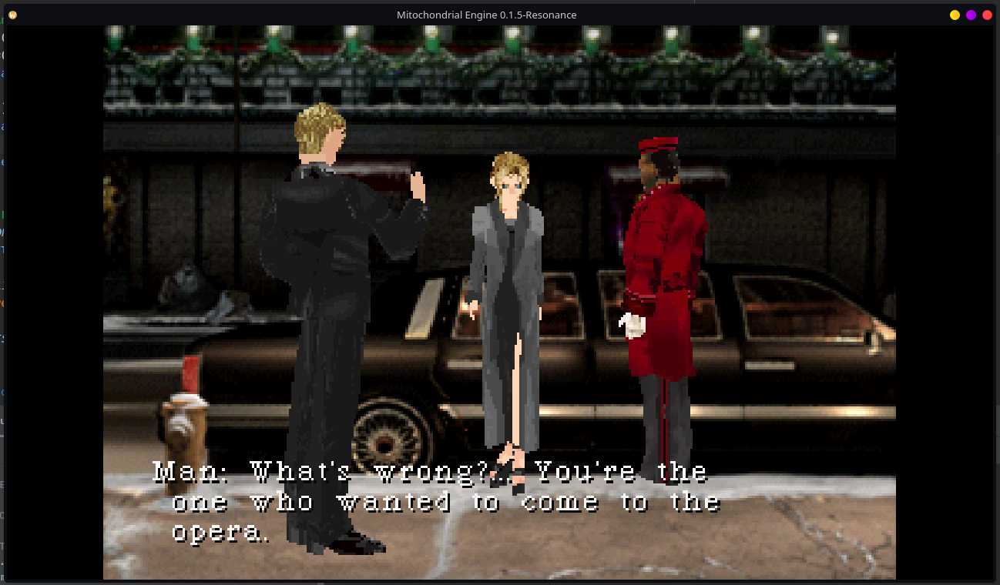
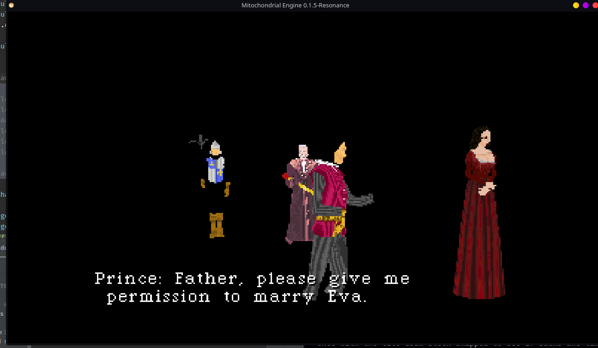
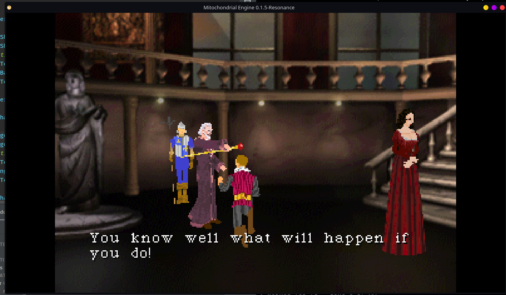

# Mitochondrial Engine

The Mitochondrial Engine is a Native Java PC Port of [Parasite Eve](https://en.wikipedia.org/wiki/Parasite_Eve_(video_game)) on the PS1.

It's written on top of the [UPF](https://github.com/CaptainSly/Untitled-Porting-Framework), or Untitled Porting Framework. The framework is in active development alongside ME. The [Parasite Eve Decomp](https://github.com/khasinski/parasite-eve-decomp) was used to create the port, by translating the C code to Java. 

The code has quite a few different easter eggs thrown through out it, in the form of references to a lot of different media and stuff I enjoy. Some gets logged, some are just comments. Consider it a little treat of my devolvement into madness while writing the code

# Current Status

The following is implemented and working:
- Disc and Data verification and ripping
- Rooms and Rendering
    - Load rooms by any map number
    - Pre rendered backgrounds are drawn, animated tiles (interactable animated tiles) work.
    - Viewport moving, swapping
    - Camera freezing and Unfreezing
    - Room changes via scripts
    - 3D Models with Skeletal Animation. 
    - 4bpp/8bpp texture loading with original palettes
    - See-through surfaces
    - Attaching Models to one another for overlays, following
    - Models and rooms now have lighting
- Player 
    - Player Movement, walk, run and idle with original speeds (WASD + LShift)
- NPC
    - Per actor speed scale
    - Scripted Walking, Turning toward point, facing an actor, snapping to animation anchors
- Collision
    - Floor meshes with real heights and sloped floors
    - Circle against edges and slide against walls like the original game does
    - Scripts that block and unblock individual floor triangles
    - Actors blocking each other 
- Interaction
    - Touching/Nearly Touching an actor starts their contact script
    - Reading the controller from scripts (held, just pressed, just released) (F = 'x')
- Dialogue
    - "Message Boxes" with typed out spaces and per-section timing
    - Several Messages open at once, and choice prompts with a cursor (W/S to move, F to pick)
    - Hand Pointer shows up for choices
    - Controller Button Icons (Hasn't been seen in testing yet, but is implemented in)
- Scripting
    - A VM that runs the original room scripts: Currently 130+ Op Handlers are implemented
- Combat 
    - Battle Effects (In progress)
    - You can shoot. You can't reload though.
    - ATB Gauge fills and plays sound when ready
    - Eve takes damage
    - Player panel draws
    - PE Gauge fills and plays sound when ready. 
- Sound
    - AKAO Music Sequencer, Room Music. Loops, temp and volume slides. 
    - Software SPU Voices. ADPCM, ADSR envelopes, pitch, 4-point Gaussian interpolation, and pitch modulation
    - Software reverb
    - Sound Effects. Per room. Nested Effect sequencer on its own clock. Script effects. Footsteps from animation frames.
    - Script music control. 
    - Registered actor sounds
    - Effect pan and volume
- Movies
    - Opening Movie (can be skipped)
    - In Game Movies (Can't be skipped)
    - Movies are drawn letterboxed with smooth scaling

The readme_images folder contains progress images.

# System Requirements

Ram: Sure. 

Graphics Card: Anything that supports OpenGL 4.6

# Build Instructions

## Linux
Run `./gradlew installDist`. The folder that gets created is located inside the `./upf-core/build/install` folder, when we refer to the `./mitochondria` folder we really mean `./upf-core/build/install/mitochondrial-engine/bin/mitochondria` folder. Place you're Parasite Eve discs inside the `./mitochondria/data` folder under the names, `pe_disc_1.bin` and `pe_disc_2.bin`. Execute the file by running `./mitochondrial-engine` The starting map is at `map431` if you want to start it from the beginning cutscene, it's changed in the `Game.java` class inside the `init()` method. The discs can be removed after the game has fully launched and the `pe.udh` file exists. The game runs completely off the `pe.udh` file. 

## MacOS
See below

## Windows
See below

# FAQ

**Q:** Was AI used at all in the making of this port? 

**A:** As an assistant only. I use Claude, but I do not allow Claude to write any code. It can provide pseudo code, but can't write to any files, nor provide compilable Java Code. I started this port to do two things. Build a modular porting framework for different types of Console PC Ports, and to learn more about game development and design. 

**Q:** Do you provide the assets?

**A:** No. You'll need to have a *legal* copy of Parasite Eve 1 for the PS1. Both discs are required, and the Mitochondrial Engine will rip the assets from the disc, repacking them into a `.udh` file, or Untitled Porting Data Holder file. 

**Q:** Is there a Windows Binary?

**A:** Not built. If you clone the project, you can provide the Windows natives for LWJGL3, but at this point in time, I'm not sure if there is Linux semantics pushed in the code. I use Linux as my daily driver, not Windows. 

**Q:** Will there be a MacOS Binary?

**A:** Nope, and I don't plan on making one either. The PS1 Shaders are utilizing OpenGL 4.6 by choice, and MacOS dropped support for OpenGL during version 4.1.

**Q:** Can I use UPF to port a game myself?

**A:** Yes! Check out [UPF](https://github.com/CaptainSly/Untitled-Porting-Framework) to get started. 

**Q:** What can I do with modding?

**A:** When the port is functional, and has been modernized you should be able to create custom items, weapons, armors, skills, enemies, etc. But currently, nothing. The current scope right now is to port the code, then once it's functional, modernize the code so it's no longer using PS1 style functionality, and uses more modern game dev approach. Allowing for finer grain control over the data, while still functioning the way the game played on the PS1. 

# License
"Copyright (C) 2026 Azraein".

"Parasite Eve" Game Assets are not covered by the license and are not redistributed.

Do not use the names "Mitochondrial Engine" or "UPF" as your own in forks. 

The license may be subjected to changes. The Parasite Eve decomp is still choosing a license, and when they update their license, some code in the project may be subject to their new license. 

Parasite Eve belongs to Square Enix.

# References

 - [Severed Chains - Legend of Dragoon PC Port](https://github.com/Legend-of-Dragoon-Modding/Severed-Chains)
 - [Parasite Eve Decomp](https://github.com/khasinski/parasite-eve-decomp)
